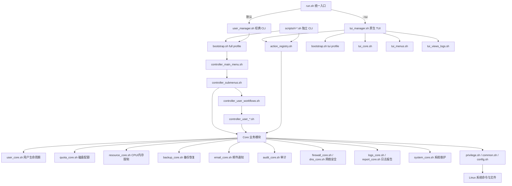
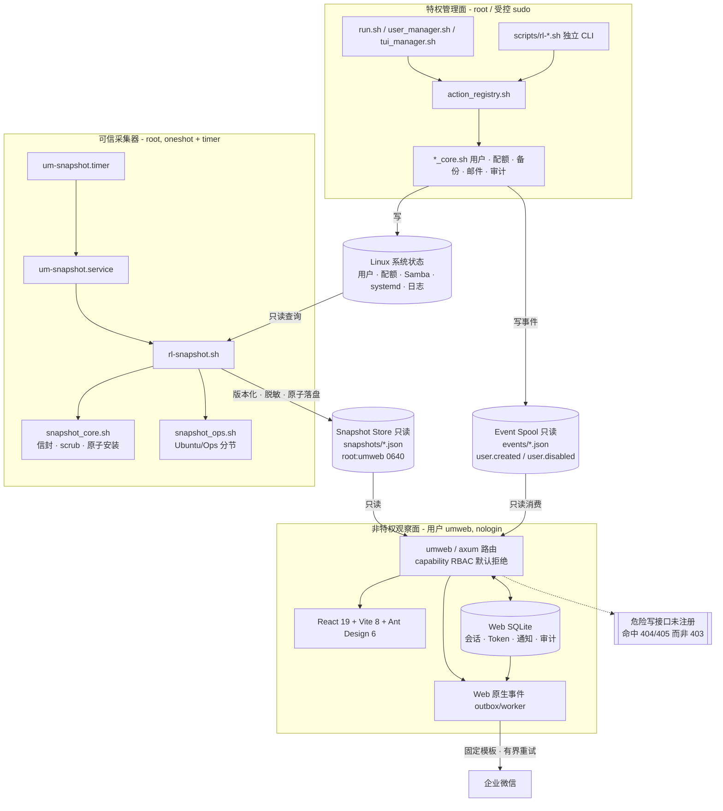

# Linux 多用户运维管理系统架构设计与功能说明

## 目录

- [1. 项目定位](#1-项目定位)
- [2. 设计目标](#2-设计目标)
- [3. 交互入口](#3-交互入口)
- [4. 总体架构](#4-总体架构)
- [5. 主执行路径](#5-主执行路径)
- [6. 核心模块](#6-核心模块)
- [7. 功能清单](#7-功能清单)
- [8. 独立 CLI 脚本](#8-独立-cli-脚本)
- [9. 典型业务流程](#9-典型业务流程)
- [10. 架构图](#10-架构图)
- [11. 架构特点](#11-架构特点)
- [12. 后续优化建议](#12-后续优化建议)

---

## 1. 项目定位

当前仓库是一个 **Bash/Shell 实现的 Linux 多用户运维管理系统**，主要面向 Ubuntu/Debian 多用户服务器环境。

项目目标是把服务器多用户场景中的常见运维任务集中到统一工具中，包括：

- 用户生命周期管理
- 用户组与权限管理
- 磁盘配额管理
- CPU/内存资源限制
- 备份与恢复
- 邮件通知
- 企业微信通知
- 网络与安全管理
- 日志、审计与报告
- 系统维护与监控

该项目更接近一个 **面向 Linux 服务器管理员的本地运维控制台**，而不是单一脚本工具。

2026-09 起，仓库在上述 Bash 本地控制台之外增加了 **Web 控制台**（`umweb`）。它是一个**非特权观察面**：提供认证、只读观测、审计查询、通知与非特权配置，但**不提供任何系统写操作**，因此不能替代 CLI/TUI 执行系统变更。Web 与 CLI/TUI 构成**双控制面**，二者之间不存在提权桥。边界定义见 [`docs/WEB_SECURITY_BOUNDARY.md`](WEB_SECURITY_BOUNDARY.md)。

> 本文描述架构与能力边界。当前状态、实测数字与未完成项分别记录在 [`docs/STATUS.md`](STATUS.md) 与 [`docs/PROGRESS.md`](PROGRESS.md)，不在此重复。

---

## 2. 设计目标

### 2.1 统一多用户运维入口

将用户创建、删除、暂停、恢复、配额、资源限制、备份、审计等能力统一到一个管理系统中，减少管理员在多个命令和配置文件之间切换的成本。

### 2.2 同时支持交互式与自动化场景

项目同时提供：

- 经典 CLI 菜单，适合普通终端交互；
- 原生 Bash TUI，适合更直观的终端操作；
- 独立 CLI 脚本，适合自动化任务、定时任务和外部脚本调用。

### 2.3 复用业务核心能力

CLI、TUI 和独立脚本入口尽量复用同一套 Core 业务模块，避免相同能力在多个入口重复实现。

### 2.4 贴近系统原生命令

项目直接封装 Linux 系统能力，例如：

- `useradd` / `usermod` / `userdel`
- `passwd`
- `quota`
- `systemd` / `systemctl`
- `journalctl`
- `rsync`
- `ufw`
- `fail2ban`

### 2.5 双控制面职责分离

系统写操作与只读观测分属两个控制面，职责不重叠：

| 控制面 | 载体 | 运行身份 | 职责 |
|---|---|---|---|
| 特权管理面 | `run.sh`、`user_manager.sh`、`tui_manager.sh`、`scripts/rl-*.sh` | root 或受控 sudo 通道 | 一切需要特权的系统变更 |
| 非特权观察面 | `web/backend`（服务进程 `umweb`）+ `web/frontend` | 普通系统用户 `umweb` | 认证、只读观测、审计查询、通知、非特权配置 |

Web 不会因为某个操作“需要权限”而请求提权：这类操作在 Web 侧**不注册对应接口**，属于不存在的能力，而不是运行期被拒绝的分支。

---

## 3. 交互入口

项目提供四类主要入口。前三类是本机特权入口，第四类是非特权 Web 入口。

| 入口类型 | 文件 | 说明 |
|---|---|---|
| 统一入口 | `run.sh` | 默认启动经典 CLI；`--tui` 仅在支持全屏 ANSI 的交互终端启动 TUI，否则回退 CLI |
| 经典 CLI 菜单 | `user_manager.sh` | noTUI/CLI 主菜单入口 |
| 原生 Bash TUI | `tui_manager.sh` | 终端图形化菜单入口 |
| 独立命令脚本 | `scripts/rl-*.sh` | 面向自动化、脚本化调用 |
| Web 控制台 | `web/backend`、`web/frontend` | 非特权 HTTP 服务与单页应用；只读观测与非特权管理，不含系统写操作 |

> Web 控制台不是第四个“等价入口”。它与前三个入口的权限模型不同：前三个在 root 或受控 sudo 通道下执行系统变更，Web 只能观察与配置自身数据。系统数据经只读快照进入 Web，详见 4.3。
>
> 部署单元为 `etc/systemd/system/umweb.service`（用户 `umweb`，`nologin`）、`um-snapshot.service` 与 `um-snapshot.timer`（root 运行的只读采集器），以及 `etc/tmpfiles.d/user-manager-web.conf`（root 拥有的事件 spool 目录）。`etc/sudoers.d/user-manager.example` 中的 `%useradm` 规则属于特权管理面的改密包装器，**与 `umweb` 无关**。

> 注意：当前 `run.sh` 默认进入 `user_manager.sh`。只有传入 `--tui` 时，才进入 `tui_manager.sh`。
>
> 如果其他文档中存在“默认启动 TUI”的描述，应以 `run.sh` 的实际行为为准。

---

## 4. 总体架构

项目整体采用分层架构：

```text
入口层
  ↓
启动加载层
  ↓
UI / Controller 层
  ↓
Action 分发层
  ↓
Core 业务层
  ↓
Privilege / System 基础层
  ↓
Linux 系统命令与文件
```

### 4.1 分层职责

| 层级 | 职责 |
|---|---|
| 入口层 | 选择 CLI、TUI 或独立脚本入口 |
| 启动加载层 | 统一加载配置、公共模块和业务模块 |
| UI 层 | 负责菜单、界面绘制、输入输出 |
| Controller 层 | 编排交互流程，例如收集参数、确认操作、进入子菜单 |
| Action 分发层 | 为 CLI/TUI/脚本提供统一动作 ID 和分发能力 |
| Core 业务层 | 执行用户、配额、备份、邮件、审计等核心逻辑 |
| 基础层 | 封装权限、配置、环境检测、日志、安全执行 |
| 系统层 | 调用 Linux 系统命令、读写系统配置和业务数据文件 |

### 4.2 核心设计思想

项目的核心设计思想是：

> **入口可以多样，业务能力应尽量统一。**

因此，TUI、经典 CLI 和独立脚本不应各自实现一套业务逻辑，而应尽量通过 `action_registry.sh`、Controller 和 `*_core.sh` 复用相同能力。

### 4.3 双控制面总体架构

上述分层只描述特权管理面。仓库同时包含一个**非特权观察面**，两者通过只读快照层单向解耦：

```text
 管理员 ──CLI / TUI──>  A. 特权管理面（root 或受控 sudo）
                        run.sh · user_manager.sh · tui_manager.sh
                        scripts/rl-*.sh · action_registry.sh · *_core.sh
                                     │ 写入系统与业务状态
                                     v
                        Linux 系统状态（用户 · 配额 · Samba · systemd · 日志）
                                     │ 只读查询
                                     v
                        可信采集器（root，oneshot + timer）
                        scripts/rl-snapshot.sh
                        lib/snapshot_core.sh（契约）
                        lib/snapshot_ops.sh（Ubuntu/Ops 分节）
                                     │ 版本化 + 脱敏 + 原子落盘
                                     v
                        Snapshot Store（只读，root:umweb 0640）
                        /var/lib/user-manager-web/snapshots
                                     │ 只读
                                     v
 浏览器 ──HTTPS──>      B. 非特权观察面（umweb，普通用户）
                        axum 路由 · capability RBAC · SQLite
                        React / Vite / Ant Design 6 单页应用
                                     │ 仅写自身 DB 与 secret
                                     v
                        /var/lib/user-manager-web
```

两个控制面之间只有两条数据通路，且方向固定：

| 通路 | 方向 | 形态 | 约束 |
|---|---|---|---|
| 快照 | root 写 → `umweb` 读 | `snapshots/*.json` | `umweb` 只读，不触发采集，不写回 |
| 事件 spool | root 写 → `umweb` 读 | `events/*.json` | 仅 `user.created` / `user.disabled`，`umweb` 只读消费 |

不存在反向通路：Web 无法写入系统、无法触发采集器、无法调用 CLI/TUI 的特权动作。

### 4.4 不可动摇的 Web 安全边界

以下是硬约束，由 `scripts/check_web_security.sh` 对 `web/backend/src` 做阻断式扫描，并接入 CI 与 Shell 回归：

- **永不提权**：`umweb` 不使用 root/sudo/setuid/capability，不接触特权 socket；`umweb.service` 显式设置 `NoNewPrivileges=yes`、`CapabilityBoundingSet=`、`AmbientCapabilities=`，并以 `InaccessiblePaths` 屏蔽 docker、containerd、podman、systemd private 与 dbus 控制面 socket。
- **不执行系统写操作**：不调用 `action_run` / `priv_exec` / `useradd` / `setquota` / `pdbedit`（写）/ `systemctl`（写）等写路径。
- **不派生进程**：不 fork shell、bash、任意命令或任意 SSH。
- **危险接口根本不存在**：users / SMB / hosts / system 的写路由**不注册**，因此命中返回 **404/405 而不是 403**。为保住该语义，CSRF/Origin 校验只挂在已注册的变更路由上，不作为全局中间件。
- **系统数据只经只读快照观测**：Web 从不主动触发采集，也不写回快照。
- **能力默认拒绝**：角色只有 `viewer` / `operator` / `web_admin`，不存在 owner/root/superadmin；Web 角色**不映射** Linux ACL。
- **Secret 不进入可观测面**：TOTP secret 与企业微信 webhook 用 Web 独立 master key 加密存储；GET、日志、审计与错误响应均不回显明文；API Token 只存 SHA-256 hash。
- **无 sudo 授权**：`umweb` 不出现在任何 sudoers 规则中。

完整定义、快照信封 schema 与验收映射见 [`docs/WEB_SECURITY_BOUNDARY.md`](WEB_SECURITY_BOUNDARY.md)。

---

## 5. 主执行路径

### 5.1 经典 CLI 路径

```text
run.sh
  ↓
user_manager.sh
  ↓
lib/bootstrap.sh
  ↓
um_load_profile full
  ↓
lib/controller_main_menu.sh
  ↓
lib/controller_submenus.sh
  ↓
lib/controller_user_workflows.sh
  ↓
lib/controller_user_*.sh
  ↓
lib/*_core.sh
```

经典 CLI 路径主要负责传统菜单式交互，适合在普通终端中逐步完成管理任务。

### 5.2 TUI 路径

```text
run.sh --tui
  ↓
tui_manager.sh
  ↓
lib/bootstrap.sh
  ↓
um_load_profile tui
  ↓
lib/tui_core.sh
  ↓
lib/tui_menus.sh
  ↓
lib/tui_views_logs.sh
  ↓
lib/action_registry.sh
  ↓
controller / core modules
```

TUI 路径负责终端可视化菜单、表格、输入框、状态栏、日志视图等。它先验证 stdin/stdout、`TERM` 和 `tput cup`；`TERM=dumb`、管道或不支持光标寻址时，`run.sh --tui` 会回退经典 CLI。

### 5.3 独立 CLI 脚本路径

```text
scripts/rl-*.sh
  ↓
lib/bootstrap.sh
  ↓
um_load_profile full
  ↓
lib/action_registry.sh
  ↓
rl_action_run / action_run
  ↓
lib/*_core.sh
```

独立 CLI 脚本适合自动化调用，例如：

```bash
scripts/rl-user-list.sh
scripts/rl-user-create.sh
scripts/rl-user-quota.sh
scripts/rl-backup-run.sh
scripts/rl-audit-query.sh
```

### 5.4 SSH 只读主机路径

```text
scripts/rl-hosts.sh
  ↓
lib/bootstrap.sh (remote profile)
  ↓
host_inventory.sh → execution_plan.sh
  ↓                     ↓
LocalProvider       SSHProvider
  ↓                     ↓
host_probe_core.sh / gpu_core.sh   固定远端白名单入口
  ↓                     ↓
统一 result.* / summary.* 输出与本地审计摘要
```

该路径仅支持 `host.probe` 和 `gpu.summary`。Inventory 是非执行文本，Planner 先生成确定计划；`--dry-run` 不进行网络或能力探测。SSH Provider 使用专用 known_hosts、严格主机密钥校验、无用户 SSH config、连接/存活/动作三层超时和两个常量远端命令。详见 [`docs/REMOTE_HOSTS.md`](REMOTE_HOSTS.md)。

### 5.5 只读快照采集与 Web 读取路径

这是 Web 唯一的系统数据入口，与上面四条特权路径完全分离：

```text
um-snapshot.timer
  ↓
um-snapshot.service（User=root，Type=oneshot）
  ↓
scripts/rl-snapshot.sh
  ↓
lib/bootstrap.sh + lib/snapshot_core.sh（信封构造 · secret scrub · 原子安装）
  ↓ lib/snapshot_ops.sh（Ubuntu/Ops 只读分节采集）
只读 Core 查询结果
  ↓
/var/lib/user-manager-web/snapshots/<kind>.json + manifest.json（root:umweb 0640，目录 0750）
  ↓
umweb（store/snapshot.rs 只读解析与校验）
  ↓
/api/users · /api/users/:username/quota · /api/users/:username/resources
/api/resources/summary · /api/smb/* · /api/hosts/* · /api/system-summary
  ↓
前端只读数据页（附 fresh / stale / 缺失标识）
```

采集器与 Web 服务是两个独立 systemd 单元，互不调用：`um-snapshot.service` 不启动 Web，`umweb.service` 不运行采集脚本。

快照类型与新鲜度阈值（秒）由 `lib/snapshot_core.sh` 的 `snapshot_kind_threshold` 统一定义：

| kind | 阈值 | 覆盖内容 |
|---|---|---|
| `system` | 60 | 系统、CPU/内存/PSI |
| `resources` | 60 | 资源限制与占用 |
| `logs` | 60 | 允许清单日志源（boot / failed-services / auth-failures） |
| `hosts`、`gpu` | 120 | 主机清单与 GPU 摘要 |
| `audit-summary` | 30 | 审计摘要 |
| `users`、`quota`、`smb` | 300 | 用户、配额、Samba |
| `reports` | 300 | 报告元数据索引 |
| `manifest` | 120 | schema 版本、类型与清单 |

Web 不触发刷新。快照超过阈值时，接口与界面显式标记为 stale 或缺失，不伪装实时；`manifest` 的校验负责把无效、partial、unavailable 等状态如实传给前端。

---

## 6. 核心模块

### 6.1 启动与公共基础模块

| 模块 | 职责 |
|---|---|
| `lib/bootstrap.sh` | 统一模块加载入口，提供 `full`、`minimal`、`tui`、`remote` profile |
| `lib/common.sh` | 公共输出、输入验证、安全执行、菜单循环、缓存等能力 |
| `lib/config.sh` | 配置加载与默认配置 |
| `lib/env_core.sh` | 环境探测与能力判断 |
| `lib/privilege.sh` | root 权限与特权命令封装 |
| `lib/access_control.sh` | 访问控制 |
| `archive/lib/privilege_cache.sh` | 权限相关缓存（已归档，未接入运行时） |
| `lib/async_core.sh` | 异步执行基础能力 |
| `lib/proc_manager.sh` | 进程管理 |

### 6.2 UI 与菜单模块

| 模块 | 职责 |
|---|---|
| `lib/tui_core.sh` | 原生 Bash TUI 绘制框架 |
| `lib/tui_menus.sh` | TUI 菜单数据定义与渲染引擎 |
| `lib/tui_views_logs.sh` | TUI 日志视图 |
| `lib/ui_modern.sh` | 现代 CLI 颜色、样式、组件 |
| `archive/lib/ui_menu_modern.sh` | 现代菜单 UI 组件（已归档，未接入运行时） |
| `lib/controller_main_menu.sh` | 经典 CLI 主菜单控制器 |
| `lib/controller_submenus.sh` | 经典 CLI 子菜单控制器 |
| `lib/action_registry.sh` | CLI/TUI 共用动作注册与分发 |

### 6.3 用户管理模块

| 模块 | 职责 |
|---|---|
| `lib/user_core.sh` | 用户 CRUD、密码、暂停恢复、邮箱配置、组权限等 |
| `lib/controller_user_workflows.sh` | 用户工作流聚合控制器 |
| `lib/controller_user_listing.sh` | 用户列表与查看 |
| `lib/controller_user_passwords.sh` | 密码修改与轮换 |
| `lib/controller_user_password_change.sh` | 密码变更辅助 |
| `lib/controller_user_lifecycle.sh` | 删除、重命名、暂停、恢复等生命周期操作 |
| `lib/controller_user_provisioning.sh` | 用户创建与更新流程 |
| `lib/controller_user_provisioning_support.sh` | 用户创建辅助逻辑 |
| `lib/controller_user_limits.sh` | 用户配额与资源限制控制器 |
| `lib/controller_user_groups.sh` | 用户组管理 |
| `lib/controller_user_permissions.sh` | 用户权限管理 |
| `lib/controller_user_notifications.sh` | 用户通知相关流程 |

### 6.4 磁盘与资源限制模块

| 模块 | 职责 |
|---|---|
| `lib/quota_core.sh` | 磁盘配额查询、设置、统计、数据盘匹配 |
| `lib/resource_core.sh` | CPU/内存限制，基于 systemd cgroup v2 与 ulimit |
| `lib/report_core.sh` | 配额、资源、用户、日志等报告生成 |

### 6.5 备份恢复模块

| 模块 | 职责 |
|---|---|
| `lib/backup_core.sh` | 用户数据备份、恢复、定时任务、批量备份 |
| `lib/backup_verify.sh` | 备份校验 |
| `lib/backup_excludes.sh` | `rsync` 排除规则 |

### 6.6 邮件与通知模块

| 模块 | 职责 |
|---|---|
| `lib/email_core.sh` | 邮件模块兼容桥，聚合邮件相关子模块 |
| `lib/rl_mail_config.sh` | SMTP 配置加载与校验 |
| `lib/rl_mail_template.sh` | 邮件模板渲染 |
| `lib/rl_mail_sender.sh` | 邮件发送后端 |
| `lib/rl_mail_queue.sh` | 邮件队列 |
| `lib/rl_mail_events.sh` | 邮件事件封装 |
| `lib/rl_mail_audit.sh` | 邮件审计 |
| `lib/rl_wecom_bot_sender.sh` | 企业微信机器人通知 |
| `lib/email_daemon.sh` | 邮件后台处理能力 |
| `templates/email/*.html` | 邮件 HTML 模板 |

### 6.7 网络与安全模块

| 模块 | 职责 |
|---|---|
| `lib/firewall_core.sh` | UFW 防火墙、端口规则、服务模板 |
| `lib/dns_core.sh` | DNS 白名单、DNS 限制、批量应用、规则刷新 |
| `lib/security_baseline_core.sh` | SSH 安全基线、认证失败、fail2ban 管理 |
| `lib/network_stack_core.sh` | 网络栈诊断 |
| `lib/symlink_core.sh` | 用户符号链接、共享链接、断链清理 |
| `lib/smb_core.sh` | SMB 账户同步、共享管理、主配置 include 自动化 |
| `lib/host_inventory.sh` | 非执行式主机清单校验、加载和稳定目标展开 |
| `lib/host_provider.sh` | Local/SSH 只读 Provider、严格 SSH 参数、输出协议校验 |
| `lib/execution_plan.sh` | dry-run、顺序执行、逐主机结果与 best-effort 汇总 |

### 6.8 日志、审计与报告模块

| 模块 | 职责 |
|---|---|
| `lib/audit_core.sh` | 操作审计、审计查询、统计、轮转 |
| `lib/logs_core.sh` | 统一日志读取服务 |
| `lib/logs_presenter.sh` | 日志展示格式化 |
| `lib/journalctl_core.sh` | journald/systemd 日志读取 |
| `lib/tui_views_logs.sh` | TUI 日志查看界面 |
| `lib/report_core.sh` | HTML 报告、CSV 导出、异常检测、趋势分析 |

### 6.9 系统维护与监控模块

| 模块 | 职责 |
|---|---|
| `lib/system_core.sh` | 系统信息、内存、硬件、崩溃诊断、监控入口 |
| `lib/ubuntu_maintenance_core.sh` | APT 更新、重启需求、软件源、包状态摘要 |
| `lib/systemd_timer_core.sh` | systemd timer 安装、查看、删除、日志 |
| `lib/vm_core.sh` | 虚拟机状态与列表 |
| `lib/gpu_core.sh` | GPU 状态、设备、进程与结构化只读摘要（nvidia-smi → lspci 降级） |
| `lib/host_probe_core.sh` | 系统、架构、Bash、systemd/cgroup 能力的版本化只读快照 |
| `lib/shell_config.sh` | Shell 配置 |
| `lib/miniforge_core.sh` | Miniforge 安装与配置 |
| `lib/lock_core.sh` | 锁机制 |

### 6.10 Web 控制台后端模块

服务进程 `umweb`，crate 名 `umweb`，运行于 `web/backend`。

| 模块 | 职责 |
|---|---|
| `web/backend/src/main.rs` | 二进制入口（薄封装，转 `lib::run`） |
| `web/backend/src/lib.rs` | crate 根，组装监听、后台任务与中间件层序 |
| `web/backend/src/config.rs` | 环境配置与角色→能力 allowlist（默认拒绝） |
| `web/backend/src/state.rs` | `AppState`（DB、会话、限流、能力集合） |
| `web/backend/src/error.rs` | 统一错误到 HTTP 的映射（脱敏） |
| `web/backend/src/telemetry.rs` | 结构化日志与 secret redaction |
| `web/backend/src/crypto.rs` | AES-256-GCM、HMAC、SHA-256 等加密原语 |
| `web/backend/src/auth/password.rs` | Argon2id 密码哈希 |
| `web/backend/src/auth/session.rs` | 服务端会话（hash-only、HttpOnly/Secure/SameSite=Strict Cookie） |
| `web/backend/src/auth/mfa.rs` | TOTP 注册、启用、登录挑战、停用 |
| `web/backend/src/auth/rbac.rs` | capability 判定（默认拒绝） |
| `web/backend/src/auth/guard.rs` | 会话 / Bearer 认证入口 |
| `web/backend/src/auth/csrf.rs` | 变更路由的 CSRF 与 Origin 校验 |
| `web/backend/src/auth/rate_limit.rs` | IP + username 双维限流与指数退避 |
| `web/backend/src/http/routes.rs` | 路由装配；只对已注册变更路由挂 CSRF 层 |
| `web/backend/src/http/middleware.rs` | request-id 与安全响应头 |
| `web/backend/src/http/read_api.rs` | 只读系统 API（users/quota/resources/smb/hosts/gpu/system-summary） |
| `web/backend/src/http/audit_api.rs` | 审计查询、过滤、游标与有界导出 |
| `web/backend/src/http/logs_api.rs` | 允许清单日志源读取与下载 |
| `web/backend/src/http/reports_api.rs` | 报告元数据索引与导出 |
| `web/backend/src/http/admin_api.rs` | Web 用户管理与 MFA 端点 |
| `web/backend/src/http/tokens_api.rs` | API Token 签发、列举与撤销（仅限只读 capability） |
| `web/backend/src/http/notifications_api.rs` | 通知 inbox 读取、未读计数、已读标记 |
| `web/backend/src/http/wecom_api.rs` | 企业微信设置、测试投递与投递历史 |
| `web/backend/tests/api_contract.rs` | 危险路由必须 404/405、capability 默认拒绝的契约测试 |

### 6.11 Web 前端模块

`web/frontend`，技术栈为 **React 19.3.0 + Vite 8.3.0 + Ant Design 6.6.4**，共 6 个源文件约 1628 行。

| 文件 | 职责 |
|---|---|
| `web/frontend/src/main.jsx` | React 挂载入口 |
| `web/frontend/src/App.jsx` | 应用壳：Header、Sider、导航、主题与国际化、快照新鲜度全局提示 |
| `web/frontend/src/pages.jsx` | 各业务页面（登录/MFA、Dashboard、用户、配额、资源、SMB、主机/GPU、系统状态、日志、审计、报表、通知、设置等） |
| `web/frontend/src/ui.jsx` | 自建薄壳组件：表格、描述列表、表单、结果态等 antd 6 封装 |
| `web/frontend/src/api.js` | API 客户端与会话、CSRF 处理 |
| `web/frontend/src/styles.css` | 样式与响应式规则 |

前端**不使用** Umi、Ant Design ProComponents 或 ProLayout。应用壳布局、capability 门控、请求封装与国际化切换均为自建薄壳，组件一律使用 antd 6 原生组件。构建产物为单一 `dist` 目录，由反向代理交付。选择背景见根目录 [`plan.md`](../plan.md) 的技术选型变更说明，运行与目录说明见 [`web/README.md`](../web/README.md)。

### 6.12 只读快照层与事件通道

| 模块 | 职责 |
|---|---|
| `scripts/rl-snapshot.sh` | 可信采集器入口（root 运行），把只读 Core 查询收敛为 JSON 快照 |
| `lib/snapshot_core.sh` | 快照契约：schema 版本、secret scrub、原子安装、文件名白名单、freshness 阈值 |
| `lib/snapshot_ops.sh` | Ubuntu/Ops 只读分节采集；每节自带可用性，单节不可用不丢弃其余分节 |
| `web/backend/src/store/snapshot.rs` | 快照只读解析与信封校验 |
| `web/backend/src/store/snapshot_observer.rs` | 快照新鲜度状态观测 |
| `web/backend/src/store/event_spool.rs` | root 事件 spool 的只读入库与幂等去重 |
| `web/backend/src/event_spool.rs` | spool 消费循环：固定路径、`O_NOFOLLOW` 只读打开，不写回 spool |
| `web/backend/src/store/notification.rs` | 通知 inbox 存储与去重 |
| `web/backend/src/store/web_event_delivery.rs` | Web 原生事件 outbox、限流与投递历史 |
| `web/backend/src/web_event_delivery.rs` | 原生事件投递循环（独立于 root spool） |
| `web/backend/src/store/wecom.rs` | 企业微信加密设置、订阅与投递历史 |
| `web/backend/src/store/web_audit.rs` | Web 侧操作审计 |

Web 自身数据库只保存 Web 数据，不含系统数据、不含明文 secret，表集合为：`web_users`、`sessions`、`api_tokens`、`wecom_settings`、`wecom_deliveries`、`notifications`、`web_audit`、`web_event_delivery_queue`、`web_event_delivery_throttle`、`wecom_event_throttle`、`event_spool_records`、`snapshot_freshness_observer`。

### 6.13 通知链路

通知有两条彼此独立的链路，都不要求 Web 获得任何特权。

**链路一：CLI root event spool → Web inbox → 企业微信**

```text
CLI/TUI 以 root 执行用户生命周期变更
  ↓ 写 root 拥有的 spool
/var/lib/user-manager-web/events/<id>.json（目录 root:umweb 0750）
  ↓ umweb 只读消费（event_spool.rs，固定路径，不写回）
user.created / user.disabled → 幂等入库 → Web 通知 inbox
  ↓
企业微信（按订阅设置、固定模板、按事件类型与用户五分钟去重）
```

**链路二：Web 原生事件 → 独立 outbox/worker → 企业微信**

```text
Web 自身行为：登录密码校验失败、Token 首次成功撤销、快照 fresh/stale 转换
  ↓ inbox 与 outbox 在同一事务写入
web_event_delivery_queue
  ↓ 独立非特权 worker，固定消息模板，有界重试
企业微信
```

两条链路的隔离性是刻意设计：worker 不读写 root spool，spool 只承载用户生命周期事件。原生事件的消息文本由事件类型枚举生成，不外发通知标题、摘要、目标、来源、用户名、IP、Token 标识或密码。重试只覆盖网络错误、超时、HTTP 429 与 5xx，且有次数上限；dry-run 只写本地投递历史，不产生外部请求。事件目录、模板与投递限制见 [`docs/wecom-native-events.md`](wecom-native-events.md)。

---

## 7. 功能清单

### 7.1 用户生命周期管理

支持功能：

- 创建用户
- 更新用户配置
- 删除用户
- 重命名用户
- 修改密码
- 密码轮换
- 暂停用户
- 恢复用户
- 检查过期暂停
- 查看托管用户
- 管理用户配置 JSON
- 管理用户邮箱配置
- 创建用户时可选安装 Miniforge

关键文件：

```text
lib/user_core.sh
lib/controller_user_lifecycle.sh
lib/controller_user_provisioning.sh
lib/controller_user_passwords.sh
scripts/rl-user-create.sh
scripts/rl-user-list.sh
```

### 7.2 用户组与权限管理

支持功能：

- 加入用户组
- 移出用户组
- 查看用户所属组
- 查看组成员
- 创建用户组
- 删除用户组
- 查看权限详情
- 设置主目录权限
- 设置主目录属组
- 授予管理员权限
- 移除管理员权限

关键文件：

```text
lib/controller_user_groups.sh
lib/controller_user_permissions.sh
lib/user_core.sh
lib/access_control.sh
lib/privilege.sh
```

### 7.3 磁盘配额管理

支持功能：

- 查看数据盘概览
- 查询用户磁盘配额
- 设置用户磁盘配额
- 解析配额输入
- 汇总有配额用户
- 生成配额报告

关键文件：

```text
lib/quota_core.sh
lib/controller_user_limits.sh
scripts/rl-user-quota.sh
lib/report_core.sh
```

### 7.4 CPU/内存资源限制

支持功能：

- 查询当前资源限制
- 设置 CPU 限制
- 设置内存限制
- 运行时应用限制
- 运行时重置限制
- 移除限制
- 查询 ulimit
- 设置 ulimit
- 移除 ulimit
- 按 Linux 用户组批量应用资源策略
- 查看进程资源使用

关键文件：

```text
lib/resource_core.sh
scripts/rl-user-resource.sh
```

### 7.5 邮件通知

支持功能：

- SMTP 配置加载
- SMTP 配置校验
- 邮件模板渲染
- 密码通知邮件
- 配额告警邮件
- 账户禁用通知
- 账户恢复通知
- 账户暂停通知
- 备份完成通知
- 邮件发送重试
- 邮件队列
- 密码 secret 加密落盘（AES-256-CBC + HMAC，密钥文件 0600、明文迁移与篡改检测）
- 邮件审计
- 企业微信机器人通知
- 测试邮件发送

关键文件：

```text
lib/email_core.sh
lib/rl_mail_config.sh
lib/rl_mail_template.sh
lib/rl_mail_sender.sh
lib/rl_mail_queue.sh
lib/rl_mail_events.sh
lib/rl_mail_audit.sh
lib/rl_wecom_bot_sender.sh
templates/email/*.html
scripts/rl-mail-test.sh
scripts/verify_email_config.sh
```

### 7.6 备份与恢复

支持功能：

- 查看备份状态
- 列出已备份用户
- 手动备份用户
- 全量备份
- 增量备份
- `rsync` 备份
- 备份排除规则
- 恢复用户数据
- 设置定时备份
- 取消定时备份
- 查看备份计划
- 批量备份所有用户
- 并行备份
- 批次记录
- 从批次恢复
- 备份校验
- 备份索引

关键文件：

```text
lib/backup_core.sh
lib/backup_verify.sh
lib/backup_excludes.sh
scripts/rl-backup-run.sh
```

### 7.7 网络与安全

支持功能：

- UFW 防火墙初始化
- 添加防火墙规则
- 删除防火墙规则
- 查看用户规则
- 查看端口使用情况
- 配置端口范围规则
- 使用服务模板
- DNS 白名单管理
- 启用 DNS 限制
- 移除 DNS 限制
- 批量应用 DNS 限制
- 刷新 DNS 规则
- 查看 SSH 安全基线摘要
- 查看最近认证失败
- 查看 fail2ban 状态
- 配置 sshd jail
- 列出 fail2ban jails
- 网络栈诊断
- 符号链接与共享链接管理
- SMB 账户同步（创建/设密/禁用/启用/移除/查看）
- SMB 共享管理（列表/新增/移除共享，写入托管 drop-in 配置）
- SMB 主配置 include 自动化（幂等 ensure include）

关键文件：

```text
lib/firewall_core.sh
lib/dns_core.sh
lib/security_baseline_core.sh
lib/network_stack_core.sh
lib/symlink_core.sh
lib/smb_core.sh
scripts/rl-smb-manage.sh
```

### 7.8 日志、审计与报告

支持功能：

- 操作审计记录
- 审计日志查看
- 审计条件查询
- 审计统计分析
- 手动日志轮转
- journald 审计查看
- boot 日志查看
- 失败服务查看
- 指定服务近期日志查看
- 启动错误对比
- 系统日志文件 tail
- 认证失败日志查看
- HTML 系统报告
- 用户个人报告
- 配额报告
- 资源限制报告
- 操作趋势分析
- 异常检测
- 日志摘要
- 用户历史查询
- 日期范围查询
- CSV 导出
- 每周自动报告

关键文件：

```text
lib/audit_core.sh
lib/logs_core.sh
lib/logs_presenter.sh
lib/journalctl_core.sh
lib/tui_views_logs.sh
lib/report_core.sh
scripts/rl-audit-query.sh
```

### 7.9 系统维护与监控

支持功能：

- 系统信息概览
- 内存信息查看
- 硬件健康检查
- 系统日志分析
- Ubuntu APT 维护摘要
- 重启需求检查
- systemd timers 管理
- btop/htop/glances 监控入口
- 崩溃原因分析
- OOM 防护配置
- 网络信息显示
- 虚拟机列表与状态
- GPU 状态查看
- GPU 设备查看
- GPU 进程查看
- 系统概览独立脚本

关键文件：

```text
lib/system_core.sh
lib/ubuntu_maintenance_core.sh
lib/systemd_timer_core.sh
lib/vm_core.sh
lib/gpu_core.sh
scripts/rl-system-overview.sh
```

### 7.10 Web 控制台功能

只读观测：

- Dashboard 核心指标、资源与主机摘要、事件概览
- 用户列表与用户详情
- 用户配额视图
- 资源限制与占用视图
- SMB 状态、SMB 账户与共享列表
- 主机清单、主机详情与 GPU 摘要
- 系统状态摘要（systemd、APT 与重启需求、AppArmor、文件系统与 inode、PSI）
- 日志源查询与下载（限定允许清单源）
- 审计查询、过滤、游标分页与有界导出
- 报告索引与导出
- 快照新鲜度（fresh / stale / 缺失）显式标识

认证与 Web 自身管理：

- 密码 + TOTP 两步登录
- 会话列举与撤销
- Web 用户管理（Web 身份，绝不触碰 Linux 账户）
- API Token 签发、列举与撤销（仅允许只读 capability）
- 主题切换与中英文切换

通知：

- 通知 inbox、未读计数、事件类型过滤、游标分页、标记已读
- 企业微信设置、事件订阅、测试投递与投递历史

Web 侧**不提供**下列能力，且对应接口未注册（命中返回 404/405）：

- 创建、删除、禁用或修改 Linux 用户
- 设置配额、修改 CPU/内存限制
- 写入 SMB 账户或共享
- 写入主机清单或触发远端动作
- 任何系统配置写入、systemd 操作或 root 操作

---

## 8. 独立 CLI 脚本

| 脚本 | 功能 |
|---|---|
| `scripts/rl-user-list.sh` | 列出所有托管用户 |
| `scripts/rl-user-create.sh` | 创建托管用户 |
| `scripts/rl-user-quota.sh` | 查询或设置用户磁盘配额 |
| `scripts/rl-user-resource.sh` | 查询、设置、重置、移除用户资源限制 |
| `scripts/rl-mail-test.sh` | 发送 SMTP 测试邮件 |
| `scripts/rl-backup-run.sh` | 触发指定用户备份 |
| `scripts/rl-audit-query.sh` | 查询审计日志 |
| `scripts/rl-smb-manage.sh` | SMB 账户与共享管理（list/status/password/disable/enable/remove/shares/share-add/share-remove） |
| `scripts/rl-action-list.sh` | 输出 Action 表（--plain/--markdown）并校验 handler（--check） |
| `scripts/rl-chpasswd.sh` | 修改用户密码 |
| `scripts/rl-system-overview.sh` | glances 系统概览包装 |
| `scripts/rl-hosts.sh` | Inventory 校验、本机/SSH 主机能力和 GPU 只读探测 |
| `scripts/rl-remote-entry.sh` | 远端固定路径的 `host.probe` / `gpu.summary` 白名单入口 |
| `scripts/rl-snapshot.sh` | 可信只读快照采集器（root 运行，写快照目录供 Web 只读消费） |
| `scripts/verify_email_config.sh` | 验证邮箱配置 |
| `scripts/check_sensitive_files.sh` | 敏感文件/密钥扫描 |
| `scripts/normalize_echo_output.sh` | 输出规范化辅助脚本 |

独立 CLI 脚本通常遵循统一结构：

```text
定位项目根目录
  ↓
source lib/bootstrap.sh
  ↓
um_load_profile full
  ↓
action_register_defaults_once
  ↓
rl_action_run <action-id> cli "$@"
```

---

## 9. 典型业务流程

### 9.1 创建用户流程

```text
用户选择创建用户
  ↓
controller_user_provisioning.sh 收集用户名、密码、目录等参数
  ↓
user_core.sh 创建 Linux 用户
  ↓
可选：quota_core.sh 设置磁盘配额
  ↓
可选：resource_core.sh 设置 CPU/内存限制
  ↓
可选：rl_mail_events.sh 发送通知邮件
  ↓
audit_core.sh 记录审计日志
```

### 9.2 日志查询流程

```text
用户在 TUI/CLI 中选择日志功能
  ↓
action_registry.sh 分发日志 action
  ↓
logs_core.sh / journalctl_core.sh 读取日志
  ↓
logs_presenter.sh 格式化日志内容
  ↓
tui_views_logs.sh 或 CLI 输出结果
```

### 9.3 备份流程

```text
用户触发备份
  ↓
backup_core.sh 判断用户和目录
  ↓
backup_excludes.sh 应用排除规则
  ↓
rsync 执行备份
  ↓
backup_verify.sh 校验备份结果
  ↓
rl_mail_events.sh 发送备份通知
  ↓
audit_core.sh 记录审计日志
```

---

## 10. 架构图



### 10.1 简版结构图

```text
run.sh
├── user_manager.sh
│   └── controller_*
│       └── *_core.sh
├── tui_manager.sh
│   ├── tui_core.sh
│   ├── tui_menus.sh
│   ├── tui_views_logs.sh
│   └── action_registry.sh
└── scripts/rl-*.sh
    ├── action_registry.sh
    │   └── *_core.sh
    └── rl-snapshot.sh
        ├── snapshot_core.sh（契约：信封 / scrub / 原子安装）
        └── snapshot_ops.sh（Ubuntu/Ops 只读分节）

基础层：
bootstrap.sh / common.sh / config.sh / privilege.sh / env_core.sh

非特权观察面：
web/backend（umweb）
├── auth/        password · session · mfa · rbac · guard · csrf · rate_limit
├── http/        routes · middleware · read · audit · logs · reports
│                admin · tokens · notifications · wecom
└── store/       Web 自身 SQLite（users · sessions · tokens · wecom
                 notifications · audit · outbox · spool 记录）
web/frontend（React 19 + Vite 8 + Ant Design 6）
```

### 10.2 双控制面架构图



---

## 11. 架构特点

### 11.1 优点

- **分层清晰**：入口、加载、控制器、动作分发、业务核心分离明确。
- **入口多样**：同时支持经典 CLI、TUI 和独立脚本。
- **Action 可复用**：`action_registry.sh` 让 TUI/CLI 共享业务动作。
- **功能覆盖完整**：覆盖多用户服务器常见运维场景。
- **适合自动化**：`scripts/rl-*.sh` 可以被 cron、CI、运维脚本直接调用。
- **贴近系统能力**：直接封装 Linux 用户、磁盘、systemd、rsync、UFW、fail2ban 等能力。
- **双控制面职责清晰**：特权变更集中在 CLI/TUI，Web 只做观察与非特权配置，两者通过只读快照单向解耦。
- **Web 边界可验证**：提权与系统写路径由阻断式扫描约束，危险接口以“不存在”而非“被拒绝”表达。
- **数据新鲜度如实可见**：快照带 schema 版本与阈值，过期显式标记为 stale，不伪装实时。

### 11.2 当前边界

- 项目主体是 Bash/Shell，适合贴近系统命令的本地运维场景。
- 业务能力依赖宿主机系统环境，例如 Linux 发行版、systemd、UFW、fail2ban、quota 等。
- TUI 与 CLI 共享部分业务能力，但仍需要保持入口层和业务层边界清晰，避免 UI 层直接承载核心逻辑。
- 全屏 TUI 依赖交互终端与光标寻址；不可用时应使用经典 CLI，而不是强制进入 raw mode。
- SSH 基础层仅覆盖受管理员预部署的只读探测；不包含远程写操作、密钥分发、远端自动部署、GPU 调度、并发批处理或跨主机回滚。
- Web 控制台只能观察与非特权配置，任何系统变更仍须回到本机 CLI/TUI；这是设计取舍而非待补功能。
- Web 数据新鲜度受采集节奏约束；Web 不主动刷新，也不为“看起来实时”而伪装状态。
- Web 投递 worker 假定单个 `umweb` 实例独占其 SQLite 数据库，未使用跨进程租约；多实例共享同一数据库可能重复投递。
- 企业微信不提供幂等键，远端已接收但响应丢失时，有界重试或重启可能产生重复消息。

---

## 12. 后续优化建议

### 12.1 文档优化

- 将本文作为 `docs/ARCHITECTURE.md` 长期维护，并在双控制面变化时同步 4.3、4.4 与 10.2。
- 保持职责分工：本文只写架构与边界，状态与实测数字写入 [`docs/STATUS.md`](STATUS.md)，完成度与未完成项写入 [`docs/PROGRESS.md`](PROGRESS.md)，避免同一数字在三处重复。
- 为 `action_registry.sh` 补充 action ID 清单与调用示例。
- 为 `scripts/rl-*.sh` 补充统一使用说明。
- 为 Web 侧补充接口清单与 capability 对照表（可从 `web/backend/src/http/` 与 `config.rs` 导出生成）。

### 12.2 模块边界优化

- 统一 `email_core.sh` 与 `rl_mail_*.sh` 的命名边界。
- 明确 Controller 层与 Core 层职责：Controller 只做流程编排，Core 只做业务执行。
- 减少模块间隐式依赖，将共享配置和状态集中到更明确的配置层。

### 12.3 可维护性优化

- 统一错误码与返回码规范。
- 统一日志输出格式。
- 为关键业务函数补充注释和调用示例。
- 为创建用户、设置配额、资源限制、备份、审计查询等核心流程补充测试。

### 12.4 自动化与稳定性优化

- 为独立 CLI 提供稳定参数规范。
- 为自动化场景补充非交互模式约定。
- 对系统命令调用增加更明确的失败处理和回滚策略。
- 对备份、配额、资源限制等高风险操作增加 dry-run 能力。
- 为快照采集补充按 kind 独立调度，使 `audit-summary` 的 30 秒阈值不必被全量采集节奏拖累。
- 为 Web 投递 worker 增加跨进程租约或数据库级认领，使多实例部署成为受支持的形态。
- 补齐目标机部署验收：systemd 单元、快照目录与事件 spool 权限、真实企业微信 webhook 的端到端投递。
- 补齐 Web 前端的完整 WCAG 与读屏器审计；键盘可达与窄屏表格导航已具备，但不足以替代正式可访问性审计。
